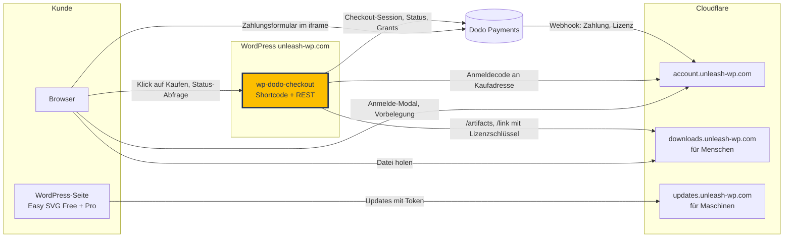
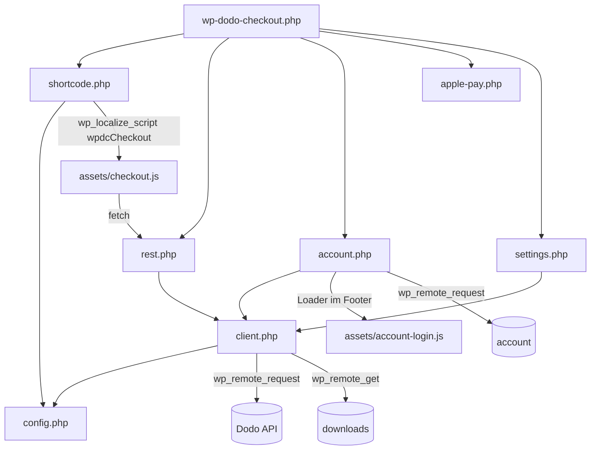
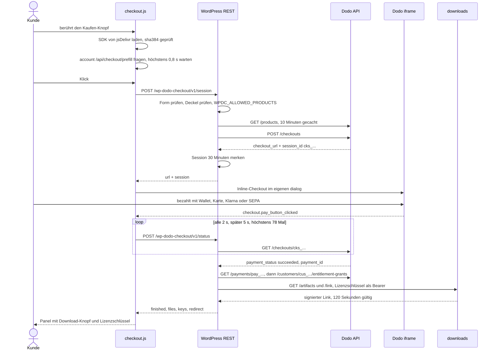
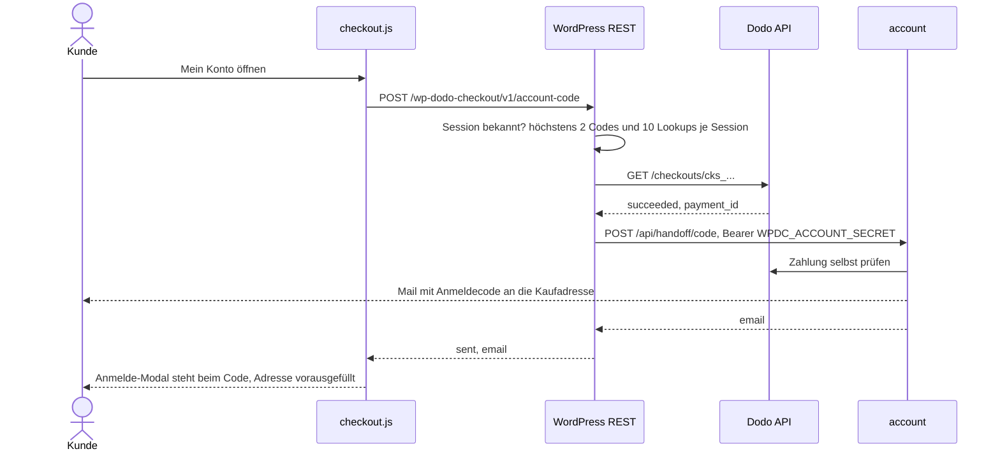
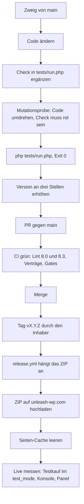

# wp-dodo-checkout: Mitarbeiter-Wiki

Stand 2026-10-25 · Version 0.17.0 · Standardzweig `main` · Repo öffentlich

Dieses Wiki erklärt dir das Plugin so, dass du eine Änderung sicher bis auf die Verkaufsseite bringst. Die
englische [README](../README.md) ist die Referenz für Shop-Betreiber; hier steht, wie es innen funktioniert.

## Inhalt

1. [In 30 Sekunden](#in-30-sekunden)
2. [Wo es im Gesamtsystem sitzt](#wo-es-im-gesamtsystem-sitzt)
3. [Aufbau](#aufbau)
4. [Wie es funktioniert](#wie-es-funktioniert)
5. [Schnittstellen nach außen](#schnittstellen-nach-außen)
6. [Einstellungen](#einstellungen)
7. [Sicherheit](#sicherheit)
8. [Lokal einrichten und starten](#lokal-einrichten-und-starten)
9. [Tests und Prüfungen](#tests-und-prüfungen)
10. [Eine Änderung hinzufügen, Schritt für Schritt](#eine-änderung-hinzufügen-schritt-für-schritt)
11. [Release](#release)
12. [Fallen](#fallen)
13. [Glossar](#glossar)
14. [Wer entscheidet was](#wer-entscheidet-was)
15. [Verwandte Repos](#verwandte-repos)

## In 30 Sekunden

- **Was:** ein WordPress-Plugin, das per Shortcode einen Dodo-Payments-Checkout in einem Modal auf die eigene
  Seite legt, mit Wallet-Knöpfen oben, optionalem Order-Bump, Rabattfeld und einem Abschluss-Panel mit
  Download-Knopf und Lizenzschlüssel.
- **Für wen:** die Verkaufsseiten von unleash-wp.com. Es enthält nichts Shop-Spezifisches; jede Seite mit
  einem Dodo-Konto kann es nutzen.
- **Wo es läuft:** in PHP auf dem WordPress-Server der Verkaufsseite, dazu zwei Skripte im Browser. Kein
  Build, kein Composer, kein Node.
- **Was es nicht tut:** keine Preise rechnen, keine Kunden speichern, keine Lizenzen ausstellen. Das macht
  Dodo (Merchant of Record) und, für das Kundenkonto, account.unleash-wp.com.

## Wo es im Gesamtsystem sitzt



Merksatz: **account ist die Wahrheit, downloads ist für Menschen, updates ist für Maschinen.** Das Plugin
spricht mit Dodo direkt (kein Zwischenserver), mit downloads nur für den Direkt-Link nach dem Kauf, und mit
account nur für den Weg ins Kundenkonto. Die Bestellung selbst bucht account über den Dodo-Webhook, nicht
über dieses Plugin.

## Aufbau

```text
wp-dodo-checkout.php     Plugin-Header, WPDC_VERSION, lädt includes/, hängt alle Hooks ein
uninstall.php            löscht beim Entfernen den gespeicherten API-Key (Option wpdc_api_key)
includes/
  config.php             Einstellungen lesen (Konstante vor Option), Grenzwerte, Validierer (pdt_, cks_, Rabattcode)
  client.php             alle Aufrufe an Dodo, Katalog-Cache, Session anlegen, Abschluss + Waren, Direkt-Link
  rest.php               die öffentlichen REST-Routen /session, /status, /price, /account-code + Deckel
  shortcode.php          [wpdc_checkout] und [wpdc_price], Dialog-Markup, Skript-Konfiguration
  account.php            [wpdc_account], Anmelde-Loader, Code an Kaufadresse, signiertes Vorbelegungs-Ticket
  apple-pay.php          liefert die Apple-Pay-Domaindatei unter /.well-known/ aus
  settings.php           Einstellungen > Dodo Checkout: Key, Modus, Produktliste mit Shortcodes
assets/
  checkout.js            Modal, SDK-Laden mit SRI, Events, Status-Poll, Abschluss-Panel, Vorbelegung
  checkout.css           Aussehen von Knopf, Dialog, Panel (per CSS-Variablen überschreibbar)
  account-login.js       das UnleashWP-Anmelde-Modal (E-Mail, Code, Proof of Work), erst beim ersten Klick geladen
  account-login.css      dazu
  brand-logo.svg, dodo-logo.svg
languages/               de_DE .po + .mo, ausdrücklich geladen (das Plugin ist nicht auf wordpress.org)
tests/run.php            die Vertragsprüfungen, reines PHP mit gestubbtem WordPress
.github/workflows/       ci.yml (Lint + Verträge), release.yml (ZIP an den Release hängen)
docs/wiki.md             diese Datei, geht nie ins ZIP
```



Hooks aus `wp-dodo-checkout.php`: `init` (Textdomain, Shortcodes, Apple-Pay-Datei), `rest_api_init`
(Routen), `wp_footer` (Anmelde-Loader), `template_redirect` (Ausgabe-Puffer für `[wpdc_account]`),
`admin_init`, `admin_menu`, `admin_notices` (Einstellungen und Warnung bei Key/Modus-Widerspruch).

## Wie es funktioniert

### Ablauf 1: Klick bis Zahlung bis Lieferung



Wichtig daran:

- Der Browser fragt seinen eigenen Server nach dem Abschluss, statt auf ein Dodo-Event zu warten. Bei einem
  auf null rabattierten Warenkorb meldet Dodos Frame nichts; deshalb startet der Poll dort schon bei
  `checkout.customer_details_submitted`.
- Lizenzschlüssel und Datei kommen bei Dodo als **zwei getrennte Grants**. `wpdc_payment_goods()` läuft erst
  alle Grants durch und baut den Direkt-Link danach. Klappt der Direkt-Link nicht, zeigt das Panel die
  Einlöseseite, der Schlüssel hängt dann hinter dem `#`.
- Name und E-Mail des Käufers verlassen den Server bei `/status` nie.

### Ablauf 2: Nach dem Kauf ins Kundenkonto



Ein Kauf allein öffnet nie ein Konto. Dodo prüft die beim Kauf getippte Adresse nicht; ein Ein-Klick-Login
nach dem Kauf wäre eine Kontoübernahme gewesen (Kauf mit fremder Adresse, danach erstatten). Der Code im
Postfach ist der Beweis. Fehlt das Secret oder scheitert etwas, öffnet das Modal beim E-Mail-Feld; die
Bestellung ist davon nie betroffen.

### Ablauf 3: Vorbelegung für angemeldete Kunden

`checkout.js` fragt beim ersten Berühren `account /api/checkout/prefill` (mit Cookie). account antwortet mit
E-Mail, Name, Rechnungsadresse und einem **signierten Ticket** (HMAC-SHA256 mit dem gemeinsamen Secret).
`wpdc_prefill_ticket()` prüft Signatur und Ablauf. Nur mit gültigem Ticket schickt das Plugin `customer_id`
und `billing_address` an Dodo und zeigt gespeicherte Zahlungsarten. Ohne Ticket gehen höchstens E-Mail und
Name mit, beide im Formular änderbar. So kann kein Browser eine fremde `customer_id` einschleusen.

### Ablauf 4: Anmelde-Modal überall

Auf jeder Seite liegt ein Loader unter 1,5 KB (`WPDC_ACCOUNT_LOGIN_LOADER` in `account.php`). Ein Klick auf
einen Link zum Konto oder ein Element mit `data-uwp-login` lädt `account-login.js`. Das Modal spricht direkt
mit account: Proof of Work holen, Code anfordern, Code prüfen. Wer schon angemeldet ist, landet sofort in
einem neuen Tab bei den Downloads. `[wpdc_account]` ist das Personen-Symbol für den Header; weil manche
Theme-Elemente Shortcodes roh ausgeben, sucht ein Ausgabe-Puffer (`wpdc_account_buffer`) die fertige Seite
einmal danach ab, nur in Textknoten.

## Schnittstellen nach außen

### Was das Plugin anbietet (alle öffentlich, ohne Nonce)

| Wer ruft | Methode | Pfad | Antwort | Fehlerfälle |
|---|---|---|---|---|
| checkout.js | POST | `/wp-json/wp-dodo-checkout/v1/session` | `{url, session}` | 400 `unknown_product` oder falsche Form, 429 Deckel voll, 503 Dodo nicht erreichbar |
| checkout.js | POST | `/wp-json/wp-dodo-checkout/v1/status` | `{finished, redirect, files, keys}`, `private, no-store` | immer 200; unbekannte Session, Deckel, Dodo-Fehler heißen `finished:false` |
| checkout.js | GET | `/wp-json/wp-dodo-checkout/v1/price?product=pdt_...` | Preis für das Land des Besuchers | unbekanntes Produkt, Deckel: Seite behält den Grundpreis |
| checkout.js | POST | `/wp-json/wp-dodo-checkout/v1/account-code` | `{sent:true, email}` oder `{sent:false}` | immer 200, `private, no-store` |
| Apple | GET | `/.well-known/apple-developer-merchantid-domain-association` | die Datei als text/plain | 404, solange die Datei fehlt (Absicht) |
| Redakteur | Shortcode | `[wpdc_checkout]`, `[wpdc_price]`, `[wpdc_account]` | HTML | ungültige Id wird in der Seite gesagt |
| Theme | Filter | `wpdc_theme_config`, `wpdc_customer` | Dodo-Theme, Vorbelegung | |

Es gibt **keine** `admin-ajax`-Aktionen. Die Einstellungen laufen über die Settings-API (`options.php`).

### Was das Plugin aufruft

| Ziel | Methode | Pfad | Wozu |
|---|---|---|---|
| Dodo `live.`/`test.dodopayments.com` | GET | `/products?page_size=100` | Katalog = Allow-List |
| Dodo | GET | `/products/{id}/localized-prices` | Preis je Land für `[wpdc_price]` |
| Dodo | POST | `/checkouts` | Checkout-Session |
| Dodo | GET | `/checkouts/{cks}` | Zahlungsstatus |
| Dodo | GET | `/payments/{pay}`, `/customers/{cus}/entitlement-grants?page_size=100` | was geliefert wurde |
| downloads (`WPDC_DOWNLOAD_URL` bzw. `external_url` des Grants) | GET | `/artifacts`, `/link?artifact=` | Direkt-Link, Lizenzschlüssel als Bearer |
| account (`WPDC_ACCOUNT_URL`) | POST | `/api/handoff/code` | Anmeldecode an die Kaufadresse |
| Browser zu account | GET | `/api/sso/session`, `/api/checkout/prefill`, `/api/pow/challenge` | angemeldet?, Vorbelegung, Proof of Work |
| Browser zu account | POST | `/api/auth/email-otp/send-verification-otp`, `/api/auth/sign-in/email-otp` | Anmeldung im Modal |
| Browser zu account | GET | `/fonts/ubuntu.css?family=Ubuntu` | Schrift in Dodos Formular |
| Browser zu jsDelivr | GET | `dodopayments-checkout@1.9.9/dist/index.js` | Dodo-SDK, mit sha384-SRI |

Alle Server-Aufrufe: `sslverify` an, beim Direkt-Link und bei account `redirection: 0`, Timeouts 15 s beim
Klick und 4 s beim Seitenaufbau.

## Einstellungen

Alles steht in `wp-config.php`; nur Key und Modus gibt es auch als Feld unter **Einstellungen > Dodo
Checkout**. Die Konstante gewinnt, und dann ist das Feld gesperrt.

| Konstante | Standard | Wirkung |
|---|---|---|
| `WPDC_API_KEY` | Option `wpdc_api_key` | Dodo-API-Key |
| `WPDC_MODE` | `test_mode` | `live_mode` oder `test_mode`; Hinweis im Admin, wenn Key und Modus nicht passen |
| `WPDC_ALLOWED_PRODUCTS` | nicht gesetzt | Kommaliste von `pdt_`-Ids; leer heißt: nichts verkaufen |
| `WPDC_DOWNLOAD_URL` | nicht gesetzt | Einlöseseite für Lizenzschlüssel, nur `https://` |
| `WPDC_RETURN_URL` | nicht gesetzt | Danke-Seite auf dieser Site; ohne zeigt das Popup den Abschluss |
| `WPDC_ACCOUNT_URL` | `https://account.unleash-wp.com` | Kundenkonto, nur `https://`-Origin |
| `WPDC_ACCOUNT_SECRET` | nicht gesetzt | gemeinsames Secret mit account; ohne gibt es keinen Code an die Kaufadresse und kein Ticket |
| `WPDC_CHECKOUT_FONT_URL` | Ubuntu von account | Schrift-Stylesheet für Dodos Formular; Google Fonts werden abgelehnt |

Die Einstellungsseite listet jedes Produkt, das der Key verkaufen kann, mit fertigem Shortcode.

**Wo der Key wirklich liegt:** auf dem WordPress-Server. Die GitHub-Beschreibung des Repos sagt "never
reaches the site"; das stimmt so nicht. Richtig ist: der Key erreicht **nie den Browser**. Er geht nur aus
`wpdc_dodo_request()` in `client.php` als Header an Dodo, die Seite bekommt nur die URLs der eigenen
REST-Routen, und die Einstellungsseite gibt einen gespeicherten Key nie zurück.

## Sicherheit

Grundsätze, jeweils im Code begründet:

- **Dodos Produktliste ist die Allow-List.** Archivierte oder erfundene Ids scheitern vor jeder Session.
  Gegen "ein anderes, live geschaltetes Produkt kaufen" hilft `WPDC_ALLOWED_PRODUCTS` oder Archivieren.
- **Kein Nonce auf den öffentlichen Routen.** Ein abgelaufener Nonce lässt WordPress mit 403 antworten, bevor
  die Route läuft; das hat Kaufknopf und Status-Poll getötet. Die Bremse sind jetzt Deckel.
- **Deckel** (alle in `config.php`): 60 Sessions je Minute, davon 20 mit Rabattcode (gegen ein Rabatt-Orakel),
  120 Status-Abfragen je Session und Minute, 600 insgesamt, 60 Preis-Lookups je Minute, die Dodo erreichen.
- **Die Session-Id ist eine Berechtigung**: wer sie hat, bekommt Links und Schlüssel. Darum `/status` als POST,
  nie in einer URL, und nur Sessions, die diese Site selbst angelegt hat.
- **Kartendaten berühren diese Origin nie**: Dodos Formular ist ein iframe von Dodos Origin.

Härtung aus dem Audit vom 2026-10-23 (Version 0.16.5, PR #38):

| Stelle | Was jetzt gilt |
|---|---|
| unbekannte Produkt-Ids | höchstens eine erzwungene Katalog-Auffrischung je 30 s, site-weit |
| `/price` | Fehlschlag kurz gemerkt, site-weiter Deckel, gezählt werden nur Lookups, die Dodo erreichen |
| `/status`, `/account-code` | jede Antwort `private, no-store` |
| `wpdc_return_url()` | nur http und https, nur dieser Host |
| `wpdc_direct_link()` | keine Redirects, TLS geprüft, Antwort auf 64 KB begrenzt |
| Einstellungen | gespeicherter Key wird nie ausgegeben; `uninstall.php` löscht ihn |
| `[wpdc_account]`-Puffer | ersetzt nur in Textknoten, nie in Tags, script oder style |
| `/account-code` | das Kontingent sinkt erst, wenn die Zahlung wirklich `succeeded` ist; eigene Grenze für Dodo-Lookups |
| `tests/run.php` | läuft nur auf der Kommandozeile |
| Workflows | Actions auf Commit-SHAs gepinnt; Release prüft vor dem ZIP |

Bewusst offen geblieben: das gemeinsame Secret wird nicht pro Zweck abgeleitet, und das Ticket trägt kein
`aud`/Nonce. Das ist ein Vertrag zwischen zwei Repos und braucht einen abgestimmten Rollout.

## Lokal einrichten und starten

Es gibt keinen Build. Für die Prüfungen reicht PHP 8.0 oder neuer:

```bash
git clone https://github.com/unleash-wp/wp-dodo-checkout.git
cd wp-dodo-checkout
php tests/run.php
```

Zum Ausprobieren in WordPress den Ordner nach `wp-content/plugins/wp-dodo-checkout/` legen (oder verlinken),
aktivieren und in `wp-config.php` einen **Test**-Key setzen:

```php
define( 'WPDC_API_KEY', '<dein Dodo-Test-Key>' );
define( 'WPDC_MODE', 'test_mode' );
```

Dann `[wpdc_checkout product="pdt_..."]` auf eine Seite setzen; die Ids stehen unter Einstellungen > Dodo
Checkout. Nie mit einem Live-Key lokal testen: der Key kann Erstattungen auslösen.

## Tests und Prüfungen

| Prüfung | Befehl | Was sie beweist | Typisches Falschbestehen |
|---|---|---|---|
| Vertragsprüfungen | `php tests/run.php` | 372 Checks (Stand 0.16.5): Fehlervokabular, Allow-List, was im ausgehenden Request steht und was nie, Deckel, Polling-Budget unter dem Server-Deckel, Versionsgleichheit Header/Konstante/Test, keine Shop-Daten im Code | Ein Check, der Quelltext per `str_contains` liest, bleibt grün, wenn du den Code nur umformatierst. Mutationsprobe: Code umdrehen, Test muss rot werden |
| Syntax | `php -l` auf jede PHP-Datei, in CI unter 8.0 und 8.3 | PHP-8.0-Untergrenze hält | lokal nur eine Version geprüft |
| Key-Literal | in CI: `git grep -nE "(sk\|pk)_(live\|test)_[A-Za-z0-9]{8,}"` | kein echter Zahlungs-Key im Repo | prüft Werte, nicht Namen; `\b` funktioniert in POSIX-ERE nicht |
| Apple-Datei | in CI: `git ls-files --error-unmatch ...` | die Domaindatei ist nicht eingecheckt | |

Das Ergebnis liest du am **Exit-Code**, nicht an der Ausgabe: `php tests/run.php; echo $?` muss `0` sein.
Die Zeilen "the Dodo API key was refused (401) in test_mode" in der Ausgabe sind gewollt; sie stammen aus
Checks, die den Fehlerweg prüfen.

## Eine Änderung hinzufügen, Schritt für Schritt



1. `git switch -c fix/kurzer-name origin/main`
2. Ändern. PHP in `includes/`, Browser in `assets/`. Neue Texte mit `__( '...', 'wp-dodo-checkout' )`, dann
   `languages/wp-dodo-checkout-de_DE.po` ergänzen und die `.mo` neu bauen (`msgfmt`). Keine Gedankenstriche
   in deutschen Texten.
3. In `tests/run.php` einen `check( 'Name', Bedingung )` ergänzen, der das neue Verhalten festhält.
4. Den Code kurz umdrehen und sehen, dass genau dieser Check rot wird. Danach zurück, mit einem Editor, nicht
   mit `git checkout` (das wirft auch deine echten Änderungen weg).
5. `php tests/run.php; echo $?` ergibt `0`.
6. Version erhöhen: `Version:` im Header von `wp-dodo-checkout.php`, `define( 'WPDC_VERSION', ... )` dort,
   und `define( 'WPDC_VERSION', ... )` in `tests/run.php`. Nur diese Zeilen ersetzen, nie global per `sed`.
7. Dateien einzeln adden (nie `git add -A`), Commit-Betreff im Stil `0.16.6: was sich für den Kunden ändert`.
8. PR gegen `main`, CI abwarten, mergen.
9. Release wie unten. Nach dem Hochladen den Seiten-Cache der Verkaufsseite leeren.
10. Live messen: Seite neu laden, prüfen, dass `checkout.js?ver=` die neue Version trägt, im Test-Modus einen
    Kauf bis zum Panel durchspielen.

**Durchgespielt:** Du willst den Deckel für Rabatt-Sessions von 20 auf 30 je Minute heben.

- Datei: `includes/config.php`, `const WPDC_DISCOUNT_CEILING = 20;` auf `30`.
- Test: `grep -n DISCOUNT tests/run.php` zeigt den vorhandenen Check. Er füllt den Zähler mit
  `WPDC_DISCOUNT_CEILING` und erwartet 429, folgt also der Konstante und bleibt bei jedem Wert grün. Weil der
  neue Wert eine Absicht ist, ergänzt du einen Check, der ihn selbst festhält:
  `check( 'discount ceiling is 30 a minute', 30 === WPDC_DISCOUNT_CEILING );`
- Mutationsprobe: Konstante kurz auf 29, der neue Check muss rot werden, der alte bleibt grün.
- Befehl: `php tests/run.php; echo $?`, dann Version auf 0.16.6, PR, Merge, Tag.

## Release

1. Die drei Versionsstellen stimmen überein (die Tests prüfen Header gegen Konstante gegen Test).
2. Der **Inhaber** pusht den Tag `vX.Y.Z` auf `main`.
3. `.github/workflows/release.yml` auf einem GitHub-gehosteten Runner: Tag gegen Header und `WPDC_VERSION`
   prüfen, `php tests/run.php`, ZIP bauen, an den GitHub-Release hängen (`gh release create` oder `upload
   --clobber`).
4. Von Hand starten (`workflow_dispatch`) baut dasselbe ZIP nur als Artefakt, ohne Release und ohne Version zu
   verbrauchen. So lief es bisher: Stand heute gibt es im Repo noch keinen Tag und keinen Release.
5. Der Inhaber installiert das ZIP auf unleash-wp.com von Hand und leert den Seiten-Cache. Nicht auf
   wordpress.org.

**Was ins ZIP kommt:** eine Allow-List im Schritt "Build the zip": `wp-dodo-checkout.php`, `uninstall.php`,
`includes/`, `assets/`, `languages/`. `docs/`, `README.md`, `tests/`, `.github/` und Punktdateien kommen nie
mit. Es gibt bewusst keine `.distignore` und kein `export-ignore`: das ZIP entsteht nicht aus `git archive`.
Brauchst du zur Laufzeit eine neue Datei auf oberster Ebene, musst du sie dort ergänzen.

## Fallen

| Symptom | Ursache | Richtig |
|---|---|---|
| Kaufknopf antwortet 403 "Die Cookie-Prüfung ist fehlgeschlagen" | abgelaufener REST-Nonce; WordPress lehnt vor der Route ab | auf öffentlichen Routen nie einen Nonce schicken; Deckel statt Nonce |
| Bezahlt, aber "konnte nicht bestätigt werden" | Browser-Poll-Budget über dem Server-Deckel | `POLL_TRIES` in `checkout.js` bleibt unter `WPDC_POLL_CEILING`; ein Test prüft das |
| Panel zeigt keine Datei, nur die Einlöseseite mit leerem Schlüssel | Datei und Schlüssel sind zwei Grants; der Link wurde aus dem Datei-Grant gebaut | erst alle Grants lesen, dann `wpdc_direct_link()` |
| Panel bleibt leer, kein Fehler | Grant-Status mal `Delivered`, mal `delivered` | Vergleich ohne Groß/Klein |
| Erfolgscode an Kaufadresse kam lautlos nie | Dialog wird an `body` gehängt; `closest('.wp-dodo-checkout')` fand die Wurzel nicht | Wurzel immer über `rootFor()` |
| Seite springt beim Klick nach oben | Impreza animiert `a[href^="#"]` selbst | `disarmTriggers()` nimmt das `href` weg |
| `[wpdc_account]` steht roh im Header | Impreza-Textelement gibt Shortcodes ungeparst aus | Ausgabe-Puffer `wpdc_account_buffer`, nur Textknoten |
| Knopftext wird beim Hover weiß | Theme-Regel mit hoher Spezifität | eigene Regel in `checkout.css`, im Browser nachmessen |
| Nach Update sehen Besucher die alte Seite | Seiten-Cache (WP Rocket, Sprach-Cookie-Varianten) | nach jedem Update Cache leeren, `?ver=` prüfen |
| Wallet-Knopf scheint zu fehlen | Headless-Browser ohne Wallet, das Element ist dann 0 px hoch | auf einem Gerät mit Wallet prüfen; DOM-Reihenfolge entscheidet |
| Kartenfelder bleiben klein | `font_size` erreicht den Karten-Frame des Zahlungsdienstleisters nicht | Zoom 1,15 nur in Chromium (`navigator.userAgentData`) |
| Gelber Bezahlknopf unmöglich | `button_primary` färbt Radios und Fokus, der aktive Knopf nimmt `text_primary` | alles Navy, Änderungen über `wpdc_theme_config` |
| Versions-`sed` hat Kommentare umgeschrieben | globales Ersetzen der Versionsnummer | nur die `Version:`- und `define`-Zeilen anfassen |
| Key-Gate konnte nie anschlagen | `\b` gibt es in POSIX-ERE nicht | Muster gegen ein gepflanztes Leck testen, bevor du ihm traust |
| Ein Konto per Ein-Klick nach dem Kauf | Dodo prüft die Kaufadresse nicht | jeder Weg ins Konto braucht den Code im Postfach |
| Apple Pay erscheint nicht | Domaindatei fehlt oder wird von Härtungsregeln für Punktordner blockiert | Datei in den Plugin-Ordner, Auslieferung über `init`, 404 statt leerem 200 |

Drei Konsolenmeldungen gehören Dodo, nicht uns: das fehlerhafte `allow`-Attribut (`keyboard-map`), die
`postMessage`-Fehler des SDK und die Sensor-Anfragen ihres Betrugs-SDK. Keine davon stoppt einen Kauf.

## Glossar

| Begriff | Bedeutung |
|---|---|
| `pdt_...` | Dodo-Produkt-Id; steht im Shortcode, ist kein Geheimnis |
| `cks_...` | Checkout-Session-Id; im Browser eine Berechtigung für Links und Schlüssel |
| `pay_...`, `cus_...` | Dodo-Zahlung, Dodo-Kunde |
| Grant / Entitlement | was Dodo nach der Zahlung liefert: Dateien, externer Link oder Lizenzschlüssel, je ein Grant |
| Lizenzschlüssel | von Dodo ausgestellt, öffnet auf downloads die Datei und auf account die Plätze |
| Platz | eine verbundene Site einer Lizenz; verwaltet account, nicht dieses Plugin |
| Token | Zugangsdatum einer verbundenen Site für Updates; kommt in diesem Plugin nicht vor |
| Order-Bump | zweites Produkt per Checkbox im selben Checkout, immer ein Stück |
| Deckel | Obergrenze je Minute in einem Transient, für alle Besucher zusammen |
| Ticket | von account signierte Vorbelegung, nur damit gehen `customer_id` und Adresse an Dodo |
| Handoff-Code | Anmeldecode, den account nach dem Kauf an die Kaufadresse mailt |
| Proof of Work | kleine Rechenaufgabe im Anmelde-Modal gegen Mail-Spam |
| SRI | Subresource Integrity; `sha384` des gepinnten SDK, vom Browser erzwungen |
| Sidecar, Pin | Begriffe der Updater-Bibliothek in den Pro-Produkten; in diesem Repo ohne Bedeutung |

## Wer entscheidet was

| Entscheidung | Wer |
|---|---|
| Tag setzen, Release, ZIP auf unleash-wp.com installieren, Cache leeren | Inhaber |
| Dodo-Key, Modus, `WPDC_ACCOUNT_SECRET` in `wp-config.php` | Inhaber |
| Etwas entfernen (Funktion, Text, Einstellung) | Inhaber |
| Produkte, Preise, Design-Seite in Dodo | Inhaber |
| Code, Tests, PR | du, mit grüner Suite |

Dieses Repo ist öffentlich: keine Secret-Werte, keine internen Kontodaten, keine Pfade eigener Rechner in
Code, Commits oder Doku. CI läuft bewusst nur auf GitHub-gehosteten Runnern, weil ein fremder Pull Request
sonst auf einer Maschine mit unseren Schlüsseln liefe.

## Verwandte Repos

| Repo | Rolle | Wiki |
|---|---|---|
| [account](https://github.com/unleash-wp/account) | Kundenkonto, Webhook, `/api/handoff/code`, Vorbelegung | `docs/wiki.md` (privat) |
| [update-server](https://github.com/unleash-wp/update-server) | downloads, updates, composer; `/artifacts`, `/link` | `docs/wiki.md` (privat) |
| [wp-updater](https://github.com/unleash-wp/wp-updater) | Lizenz und Updates in den Pro-Produkten | `docs/wiki.md` (privat) |
| [easy-svg](https://github.com/unleash-wp/easy-svg) | Easy SVG Support Free | `docs/wiki.md` |
| [easy-svg-pro](https://github.com/unleash-wp/easy-svg-pro) | Easy SVG Support Pro, wird über diesen Checkout verkauft | `docs/wiki.md` (privat) |

## Hilfe-Widget (0.17.0)

`includes/help-widget.php` gibt im Footer jeder Seite das UnleashWP-Hilfe-Widget aus, geladen vom Hilfe-Center (`support.unleash-wp.com/_dai/api/scripts/file/scripts/uwp-help.js`), Sprache aus `wpdc_page_language()`. Änderungen am Widget brauchen also kein Plugin-Release. Abschalten: `add_filter( 'wpdc_help_widget', '__return_false' )`.
